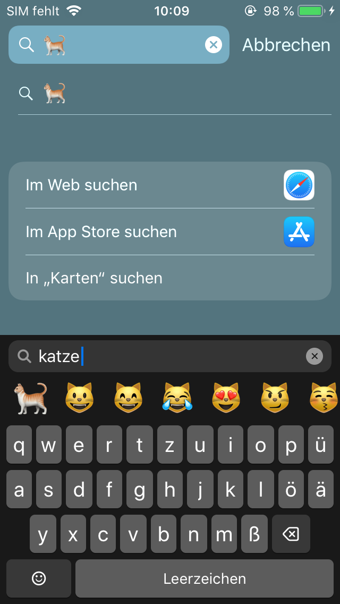

# EmojiSearch12

Emoji search for the stock keyboard on **iOS 12** (jailbreak tweak). It works like iOS 14 and later, with a search bar above the emoji.

<p align="center"></p>

- A “Search Emoji” bar at the top of the emoji keyboard
- A search panel with a results row and letter keys in the layout of your keyboard language (QWERTZ, AZERTY, QWERTY, Cyrillic, Greek, Hebrew, Arabic …)
- **Works offline:** Unicode Emoji 18.0 and CLDR 48.2 keywords in 143 languages
- Searches in the language of the last used keyboard, with English as a fallback
- Only shows emoji that the installed emoji font can render, including newer emoji added with [EmojiPort](https://github.com/PoomSmart)

## Installation
Install the `.deb` from [Releases](../../releases) with Sileo, Zebra, Cydia, Filza or `dpkg -i`, then respring.

Dependencies: `mobilesubstrate` (or libhooker/Substitute) and `preferenceloader`. Rootful only.

Tested on an iPhone 5s running iOS 12.5.8 (libhooker). The package only contains `arm64`, so on A12 devices (iPhone XS/XR) it will probably not load into Apple's own apps.

If the search bar does not show up in a particular app, check whether a tool like Choicy has disabled tweak injection for that app.

## Usage
1. In the emoji keyboard, tap “Search Emoji”.
2. Type a search term. Case and accents don't matter (“uber” finds “über”), and parts of words match (“cat” finds “wildcat”).
3. Tap a result to insert it. The panel stays open.
4. `☺︎` returns to the emoji list. For non-Latin languages, `ABC`/`🌐` switches between the language layout and QWERTY.

Skin tone variants are not listed, only the base emoji. Emoji inserted from search are not added to “Frequently Used”.

## Settings
Settings → EmojiSearch12:
- **Logging** (off by default): writes diagnostic messages to the system log. On a Mac, view them in the Console app and filter for `EmojiSearch12`. Processes without a sandbox, such as SpringBoard, also write to `/var/mobile/Library/Logs/EmojiSearch12.log`. Takes effect without a respring.

## Building
Requires macOS with the Xcode Command Line Tools and `ldid`. Theos and dpkg are not needed.

```bash
tools/fetch_deps.sh
```

```bash
CC=/Library/Developer/CommandLineTools/usr/bin/clang ./build.sh
```

`fetch_deps.sh` downloads the iPhoneOS 12.4 SDK ([theos/sdks](https://github.com/theos/sdks)), the CLDR annotations (npm packages `cldr-annotations-full` and `cldr-annotations-derived-full`) and `emoji-test.txt` from unicode.org into `deps/`. The `.deb` ends up in `build/`.

| Path | Contents |
|---|---|
| `src/Tweak.m` | The tweak: hooks, search engine, UI |
| `tools/gen_emoji_data.py` | Generates the search data for each language |
| `tools/mkdeb.py` | Builds the `.deb` (replaces dpkg-deb) |
| `tools/make_icon.m` | Generates the Settings icon |
| `prefs/` | PreferenceLoader page |

## License
Code: [MIT](LICENSE). The bundled emoji data comes from Unicode CLDR and the Unicode emoji data files and is licensed under the [Unicode License v3](LICENSE-Unicode.txt).
